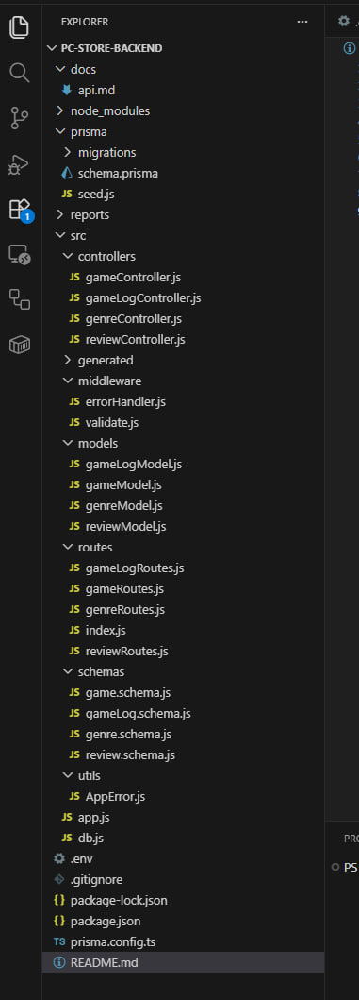
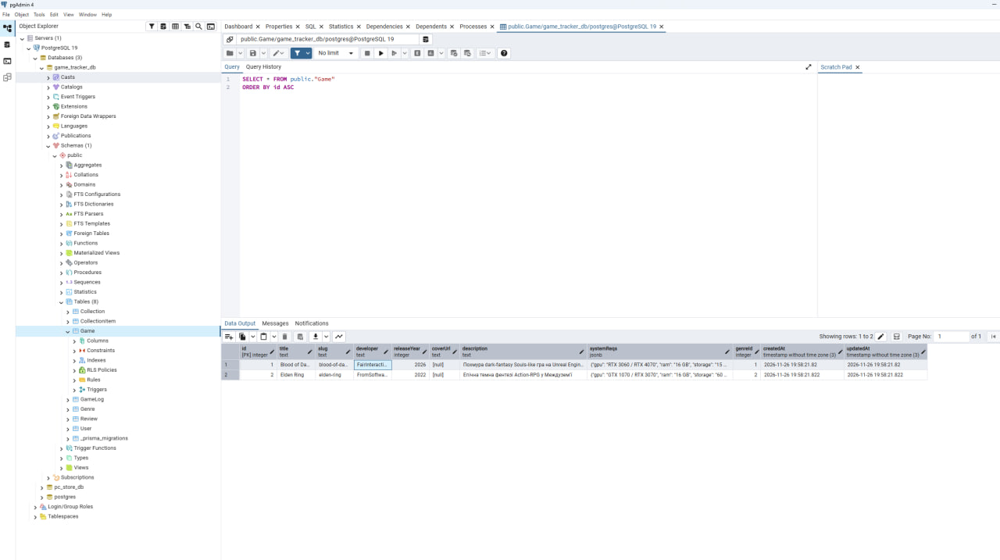
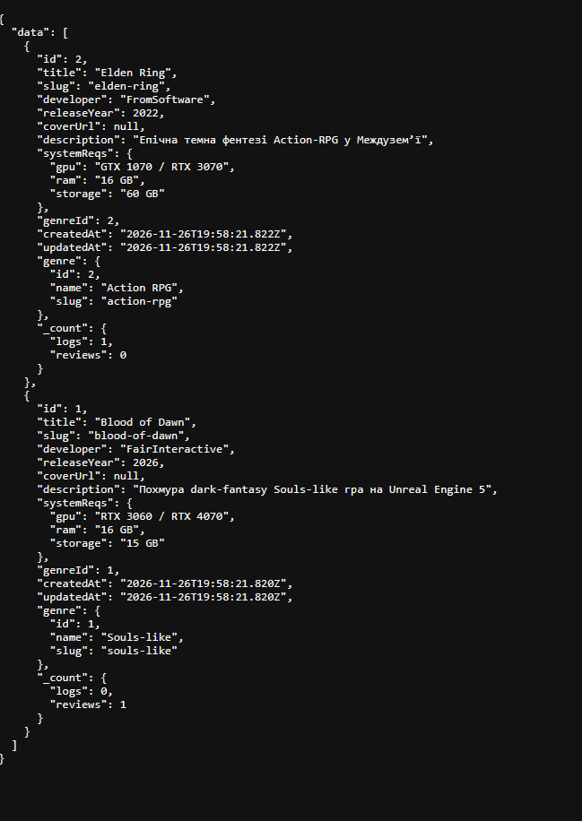
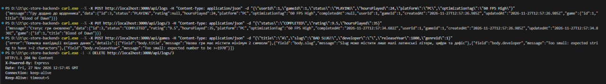
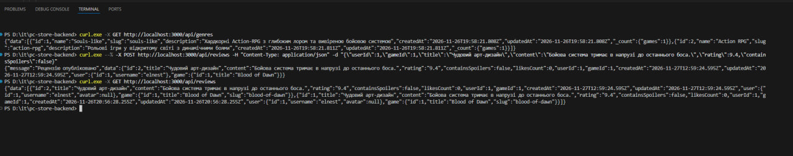

# Звіт з лабораторної роботи 1

## Тема роботи: Розроблення backend архітектури та основного функціоналу

Здобувач освіти: Скопін Денис  
Група: ІПЗ-41  
GitHub репозиторій: https://github.com/elnestt/CourseWebLab1

## Виконання роботи

### Налаштування проєкту
- Створено локальний Git-репозиторій, налаштовано `.gitignore` (виключено `node_modules/`, `.env`, `src/generated/`) та підключено віддалений репозиторій на GitHub.
- Ініціалізовано Node.js проєкт (`npm init -y`) з підтримкою ES-модулів (`"type": "module"`).
- Встановлено необхідні залежності: `express` (v5), `@prisma/client` (v7), `@prisma/adapter-pg`, `pg`, `dotenv`, `zod` та `prisma` (devDependency).
- Налаштовано змінну середовища `DATABASE_URL` та конфігурацію порту у файлі `.env`.
- Організовано шарувату структуру директорій проєкту (`src/controllers/`, `src/models/`, `src/routes/`, `src/schemas/`, `src/middleware/`, `src/utils/`, `prisma/`, `docs/`, `reports/`).

### База даних
- У середовищі **PostgreSQL 19** (через pgAdmin 4) створено реляційну базу даних `game_tracker_db`.
- У файлі `prisma/schema.prisma` спроєктовано 7 взаємопов'язаних моделей для предметної області вебсервісу обліку проходження відеоігор (**Game Tracker**):
  - `User` — облікові записи користувачів із ролями (`USER`, `MODERATOR`, `ADMIN`);
  - `Genre` — довідник жанрів відеоігор (зв'язок `1:N` із таблицею `Game`);
  - `Game` — каталог відеоігор із метаданими та системними вимогами у форматі `JSON`;
  - `GameLog` — особистий щоденник гравця зі статусами проходження (`PLAYING`, `COMPLETED`, `BACKLOG`, `DROPPED`, `WISHLIST`), оцінкою, кількістю годин, платформою та тегом оптимізації;
  - `Review` — рецензії користувачів на ігри з оцінкою та позначкою спойлерів;
  - `Collection` та `CollectionItem` — користувацькі добірки ігор (зв'язок `N:M` через проміжну таблицю).
- Виконано первинну міграцію бази даних (`npx prisma migrate dev --name init-game-tracker`), згенеровано Prisma Client та заповнено БД початковими тестовими даними через скрипт `prisma/seed.js` (`npm run db:seed`).

### Backend архітектура
- У файлі `src/app.js` реалізовано основний HTTP-сервер на базі **Express 5** із парсингом JSON-тіла запитів (`express.json({ limit: '1mb' })`), службовим маршрутом `/health` та підключенням API-роутера під префіксом `/api`.
- Реалізовано архітектуру з чітким розділенням відповідальності (MVC + шар валідації):
  - **Models** (`src/models/`) — інкапсулюють запити до PostgreSQL через Prisma ORM (включно зі зв'язками `include` та підрахунком `_count`);
  - **Controllers** (`src/controllers/`) — обробляють HTTP-запити, викликають методи моделей та повертають стандартизовані JSON-відповіді зі статус-кодами `200`, `201`, `204`;
  - **Routes** (`src/routes/`) — описують RESTful-ендпоінти та підключають проміжну валідацію.
- Впроваджено middleware:
  - `validate.js` — перевірка вхідних даних (`body`, `params`, `query`) за допомогою схем **Zod** із поверненням деталізованої помилки `400 Bad Request`;
  - `errorHandler.js` та клас `AppError.js` — централізована обробка операційних помилок, неіснуючих маршрутів (`404 Not Found`) та специфічних кодів винятків Prisma (`P2002` → `409 Conflict`, `P2025` → `404 Not Found`, `P2003` → `400 Bad Request`).

### API endpoints
Реалізовано та протестовано 4 групи RESTful-ендпоінтів (детальний опис наведено у файлі `docs/api.md`):

- **Службовий маршрут:**
  - `GET /health` — перевірка працездатності сервера.
- **Жанри (`/api/genres`):**
  - `GET /api/genres` — отримання списку всіх жанрів із кількістю ігор;
  - `GET /api/genres/:id` — отримання жанру за ID разом зі списком ігор;
  - `POST /api/genres` — створення нового жанру;
  - `PUT /api/genres/:id` — оновлення даних жанру;
  - `DELETE /api/genres/:id` — видалення жанру.
- **Каталог ігор (`/api/games`):**
  - `GET /api/games` — отримання каталогу ігор із жанрами та статистикою записів;
  - `GET /api/games/:id` — отримання детальної інформації про гру та її рецензій;
  - `POST /api/games` — додавання нової гри до каталогу;
  - `PUT /api/games/:id` — оновлення інформації про гру;
  - `DELETE /api/games/:id` — видалення гри.
- **Щоденник проходжень (`/api/logs`):**
  - `GET /api/logs` — отримання всіх записів ігрового щоденника;
  - `GET /api/logs/:id` — отримання запису щоденника за ID;
  - `POST /api/logs` — додавання гри до щоденника користувача;
  - `PUT /api/logs/:id` — оновлення статусу проходження, оцінки (`0–10`) та награних годин;
  - `DELETE /api/logs/:id` — видалення запису зі щоденника.
- **Рецензії (`/api/reviews`):**
  - `GET /api/reviews` — отримання списку всіх рецензій;
  - `GET /api/reviews/:id` — отримання рецензії за ID;
  - `POST /api/reviews` — публікація нової рецензії на гру;
  - `PUT /api/reviews/:id` — редагування рецензії;
  - `DELETE /api/reviews/:id` — видалення рецензії.

## Структура проєкту

```text
CourseWebLab1/
├── docs/
│   └── api.md
├── prisma/
│   ├── migrations/
│   ├── schema.prisma
│   └── seed.js
├── reports/
│   ├── 1.jpg
│   ├── 2.jpg
│   ├── 3.jpg
│   ├── 4.jpg
│   ├── 5.jpg
│   └── lab1-report.md
├── src/
│   ├── controllers/
│   │   ├── gameController.js
│   │   ├── gameLogController.js
│   │   ├── genreController.js
│   │   └── reviewController.js
│   ├── middleware/
│   │   ├── errorHandler.js
│   │   └── validate.js
│   ├── models/
│   │   ├── gameLogModel.js
│   │   ├── gameModel.js
│   │   ├── genreModel.js
│   │   └── reviewModel.js
│   ├── routes/
│   │   ├── gameLogRoutes.js
│   │   ├── gameRoutes.js
│   │   ├── genreRoutes.js
│   │   ├── index.js
│   │   └── reviewRoutes.js
│   ├── schemas/
│   │   ├── game.schema.js
│   │   ├── gameLog.schema.js
│   │   ├── genre.schema.js
│   │   └── review.schema.js
│   ├── utils/
│   │   └── AppError.js
│   ├── app.js
│   └── db.js
├── .env
├── .gitignore
├── package.json
├── prisma.config.ts
└── README.md
```

## Скріншоти тестування

1. **Структура директорій та файлів проєкту у VS Code:**


2. **Створені таблиці та дані в PostgreSQL (pgAdmin 4):**


3. **Отримання списку ігор (`GET /api/games` → `200 OK`):**


4. **Тестування CRUD-операцій (`POST`, `PUT`, `DELETE`) та валідації Zod (`400 Bad Request`):**


5. **Перевірка маршрутів жанрів та рецензій (`/api/genres`, `/api/reviews`):**


## Висновки

Самооцінка: 5

Обгрунтування: Усі технічні завдання лабораторної роботи виконано в повному обсязі. Спроєктовано реляційну базу даних із 7 взаємопов'язаними сутностями у PostgreSQL за допомогою Prisma ORM 7, реалізовано шарувату backend-архітектуру на Express 5, створено повний набір CRUD-маршрутів для 4 ресурсів, впроваджено сувору валідацію вхідних даних через Zod і централізовану обробку помилок, а також підготовлено документацію API та протестовано всі ендпоінти.