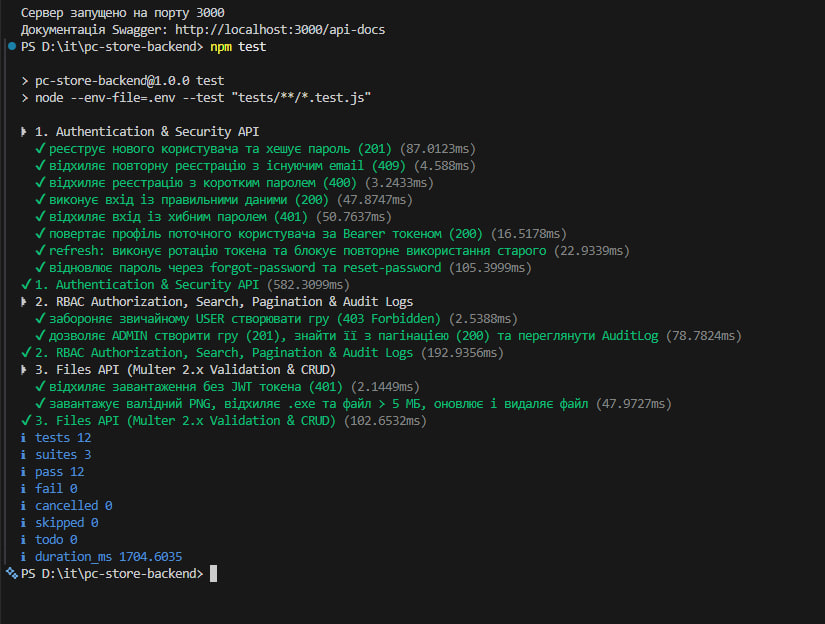
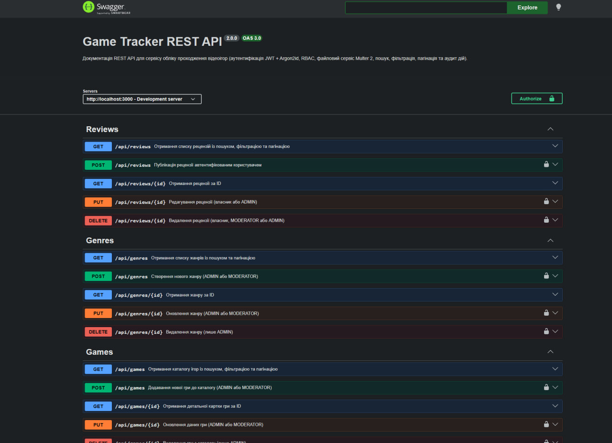
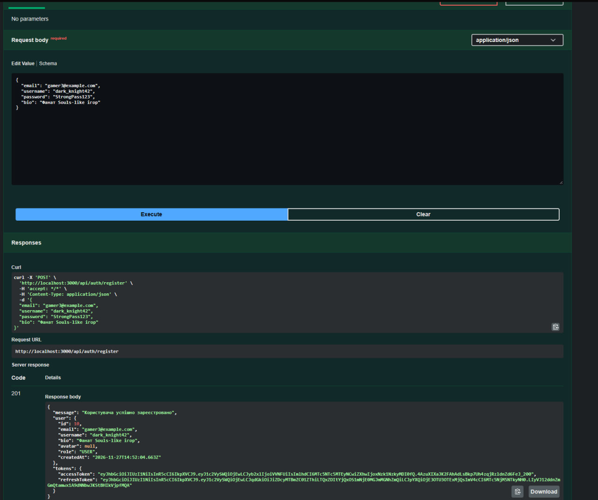
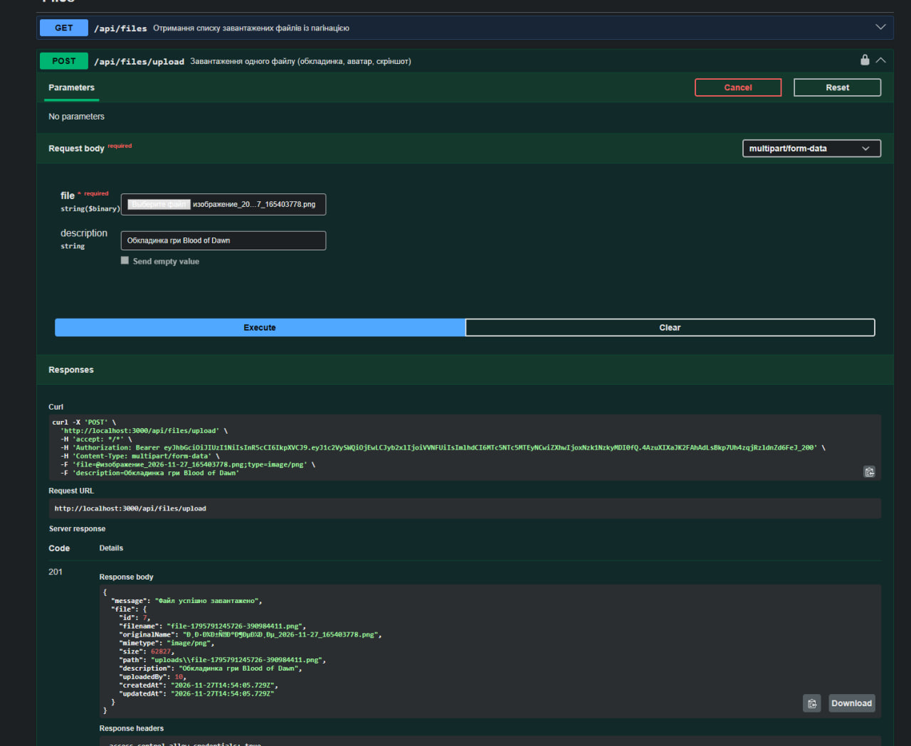
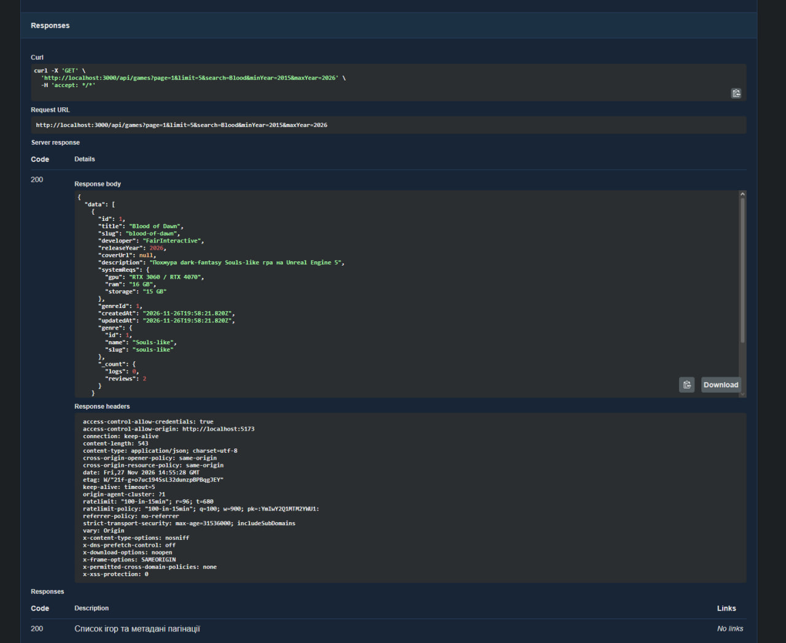

# Звіт з лабораторної роботи 2

## Тема роботи: Аутентифікація, авторизація та розширений функціонал

Здобувач освіти: Скопін Денис  
Група: ІПЗ-41  
GitHub репозиторій: https://github.com/elnestt/CourseWebLab2

## Виконання роботи

### Налаштування середовища та комплексної безпеки
- Проєкт оновлено для роботи з ES-модулями (`"type": "module"`), додано скрипти запуску (`src/server.js`) та тестування (`node --env-file=.env --test`).
- Встановлено необхідні пакети: `jsonwebtoken`, `argon2`, `multer@2`, `swagger-jsdoc`, `swagger-ui-express`, `helmet`, `express-rate-limit`, `cors` та `supertest`.
- У `.env` налаштовано криптографічно стійкі секрети `JWT_SECRET` і `REFRESH_TOKEN_SECRET`, параметри часу життя токенів (`15m` та `7d`), ліміт розміру файлів (`5 МБ`) та обмеження частоти запитів.
- Впроваджено захисні middleware у `src/app.js`: `helmet` для HTTP-заголовків безпеки, політику `cors` та `express-rate-limit` (окремий жорсткий ліміт для `/api/auth/` проти перебору паролів).

### Оновлення бази даних
- У `prisma/schema.prisma` розширено модель `User` (додано поле `password` для зберігання Argon2id-хешів та зв'язки з токенами і файлами).
- Додано 4 нові моделі та виконано міграцію `add-auth-files-audit`:
  - `File` — зберігання метаданих завантажених файлів (`filename`, `originalName`, `mimetype`, `size`, `path`, `description`);
  - `RefreshToken` — збереження SHA-256 хешів refresh-токенів для ротації та відкликання сесій;
  - `PasswordResetToken` — одноразові токени для відновлення забутого пароля;
  - `AuditLog` — журнал дій користувачів із фіксацією дії, сутності, деталей та IP-адреси.

### Система аутентифікації та авторизації (RBAC)
- Реалізовано безпечне хешування паролів за допомогою **Argon2id** (`src/utils/password.js`) та роботу з JWT (`src/utils/jwt.js`).
- Створено маршрути `/api/auth`:
  - `POST /api/auth/register` та `POST /api/auth/login` — реєстрація з валідацією Zod та вхід із видачею пари токенів;
  - `GET /api/auth/me` — отримання профілю поточного користувача;
  - `POST /api/auth/refresh` — ротація refresh-токена з автоматичним анулюванням усіх сесій при повторному використанні відкликаного токена;
  - `POST /api/auth/logout` — відкликання активного refresh-токена;
  - `PATCH /api/auth/change-password`, `POST /api/auth/forgot-password` та `POST /api/auth/reset-password` — зміна та відновлення пароля.
- Впроваджено middleware `authenticate` (перевірка `Bearer`-токена) та `authorize(...roles)` для розмежування прав доступу між ролями `USER`, `MODERATOR` та `ADMIN`.

### Файловий сервіс, пошук, фільтрація та пагінація
- Налаштовано `Multer 2.x` (`src/middleware/upload.js`) з одночасною перевіркою MIME-типу і розширення файлу (`.jpg`, `.jpeg`, `.png`, `.gif`, `.webp`, `.pdf`), генерацією унікальних імен та лімітом `5 МБ`.
- Реалізовано контролер `fileController.js` (`/api/files`): завантаження одного (`POST /upload`) та декількох файлів (`POST /upload-multiple`), отримання списку з пагінацією (`GET /`), завантаження файлу (`GET /:id`), оновлення опису або заміна файлу (`PUT /:id`) та видалення з перевіркою власника або ролі `ADMIN` (`DELETE /:id`).
- Розширено методи отримання списків для `games`, `logs`, `reviews` та `genres` підтримкою пагінації (`page`, `limit`), повнотекстового пошуку (`search`), фільтрації за критеріями (`genreId`, `minYear`, `maxYear`, `status`, `platform`, `minRating`, `containsSpoilers`) та безпечного сортування за білим списком полів.
- Додано систему аудиту дій користувачів (`GET /api/audit-logs`, доступ лише для `ADMIN`).

### Документація Swagger та тестування
- Налаштовано автоматичну генерацію документації OpenAPI 3.0 за допомогою `swagger-jsdoc` і `swagger-ui-express` на маршруті `/api-docs` із підтримкою авторизації через JWT (`bearerAuth`).
- Написано набір інтеграційних тестів (`tests/auth.test.js`) із використанням `node:test` та `supertest` (13 тестів), що перевіряють реєстрацію, вхід, ротацію refresh-токенів, відновлення пароля, RBAC-обмеження, пошук із пагінацією, аудит дій та завантаження/валідацію/видалення файлів.

## Структура проєкту

```text
CourseWebLab2/
├── docs/
│   └── api.md
├── prisma/
│   ├── migrations/
│   ├── schema.prisma
│   └── seed.js
├── reports/
│   ├── lab2-1.png
│   ├── lab2-2.png
│   ├── lab2-3.png
│   ├── lab2-4.png
│   ├── lab2-5.png
│   └── lab2-report.md
├── src/
│   ├── config/
│   │   └── swagger.js
│   ├── controllers/
│   │   ├── auditController.js
│   │   ├── authController.js
│   │   ├── fileController.js
│   │   ├── gameController.js
│   │   ├── gameLogController.js
│   │   ├── genreController.js
│   │   └── reviewController.js
│   ├── middleware/
│   │   ├── auth.js
│   │   ├── authorize.js
│   │   ├── errorHandler.js
│   │   ├── upload.js
│   │   └── validate.js
│   ├── models/
│   │   ├── gameLogModel.js
│   │   ├── gameModel.js
│   │   ├── genreModel.js
│   │   └── reviewModel.js
│   ├── routes/
│   │   ├── auditRoutes.js
│   │   ├── authRoutes.js
│   │   ├── fileRoutes.js
│   │   ├── gameLogRoutes.js
│   │   ├── gameRoutes.js
│   │   ├── genreRoutes.js
│   │   ├── index.js
│   │   └── reviewRoutes.js
│   ├── schemas/
│   │   ├── auth.schema.js
│   │   ├── game.schema.js
│   │   ├── gameLog.schema.js
│   │   ├── genre.schema.js
│   │   └── review.schema.js
│   ├── utils/
│   │   ├── AppError.js
│   │   ├── audit.js
│   │   ├── jwt.js
│   │   └── password.js
│   ├── app.js
│   ├── db.js
│   └── server.js
├── tests/
│   └── auth.test.js
├── .env
├── .gitignore
├── package.json
├── prisma.config.ts
└── README.md
```

## Скріншоти тестування

1. **Проходження автоматичних інтеграційних тестів (`npm test`):**


2. **Інтерактивна документація REST API у Swagger UI (`/api-docs`):**


3. **Реєстрація користувача та видача JWT токенів (`POST /api/auth/register`):**


4. **Завантаження файлу з перевіркою авторизації та валідацією (`POST /api/files/upload`):**


5. **Пошук та пагінація каталогу ігор (`GET /api/games`):**


## Висновки

Самооцінка: 5

Обгрунтування: Виконано всі завдання рівнів 1, 2 та додаткові вимоги рівня 3. Реалізовано реєстрацію та аутентифікацію користувачів на базі JWT і хешування паролів Argon2id, ротацію refresh-токенів із захистом від повторного використання, рольову модель доступу RBAC, зміну й відновлення пароля, файловий сервіс на Multer 2.x із валідацією типів і розміру, пошук, фільтрацію та пагінацію для основних сутностей, логування дій користувачів, захист за допомогою Helmet, CORS і Rate Limiting, інтерактивну документацію Swagger та набір автоматичних тестів.