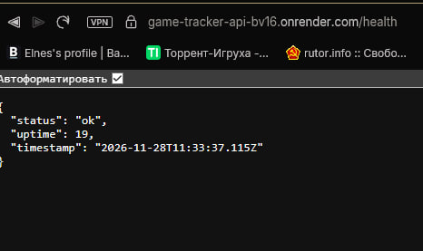
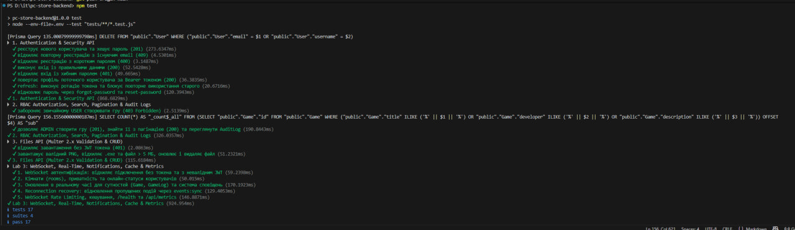
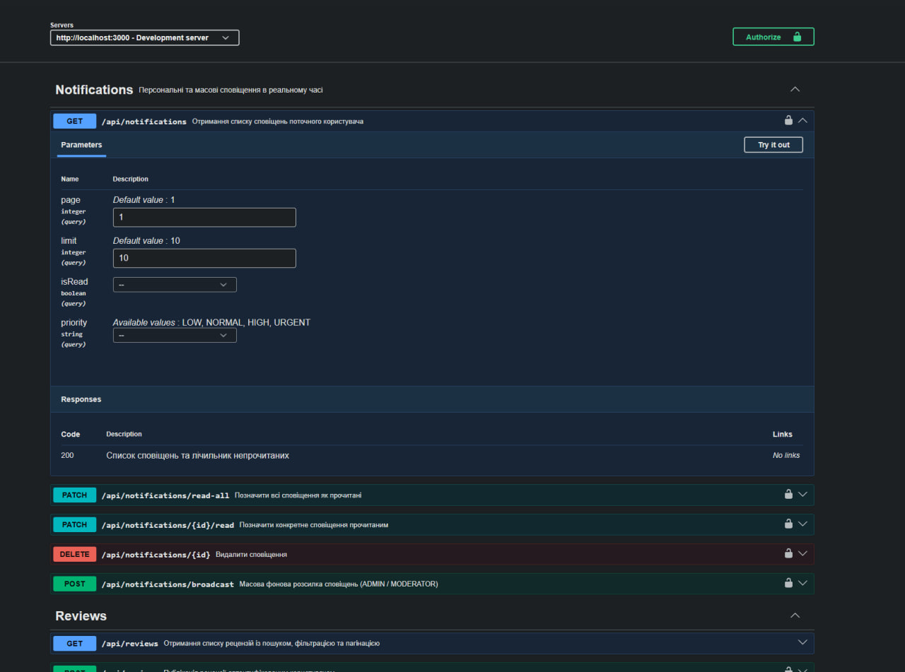
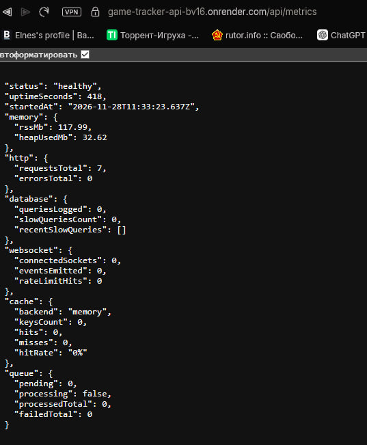

# Звіт з лабораторної роботи 3

## Тема роботи: Реалізація взаємодії в реальному часі (WebSocket), оптимізація БД, моніторинг та деплой

Здобувач освіти: Скопін Денис  
Група: ІПЗ-41  
GitHub репозиторій: [https://github.com/elnestt/CourseWebLab1](https://github.com/elnestt/CourseWebLab1)  
Розгорнутий застосунок (Render): [https://game-tracker-api-bv16.onrender.com](https://game-tracker-api-bv16.onrender.com)  
Swagger документація: [https://game-tracker-api-bv16.onrender.com/api-docs](https://game-tracker-api-bv16.onrender.com/api-docs)

## Виконання роботи

### Налаштування та інтеграція WebSocket (Socket.io)
- Встановлено необхідні залежності для двосторонньої комунікації в реальному часі та кешування: `socket.io` (v4), `@socket.io/redis-adapter`, `redis` та `socket.io-client` (devDependency для інтеграційного тестування).
- У файлах `src/server.js` та `src/socket/index.js` ініціалізовано сервер **Socket.io v4** поверх спільного HTTP-сервера Express із налаштованим CORS.
- Реалізовано middleware JWT-автентифікації для WebSocket-з'єднань: під час `handshake` перевіряється `accessToken` із `socket.handshake.auth.token`, а за відсутності або невалідності токена з'єднання відхиляється з помилкою `connect_error` (`unauthorized`).
- Впроваджено обмеження частоти вхідних подій (Rate Limiting) — не більше 30 WebSocket-подій за 10 секунд на одне з'єднання; при перевищенні ліміту сервер надсилає клієнту подію `error:ws` із кодом `RATE_LIMITED`.

### Кімнатна система, сповіщення, presence та синхронізація подій
- Спроєктовано багаторівневу систему кімнат (rooms):
  - `user:{userId}` — персональна кімната користувача для приватних сповіщень та оновлень власного щоденника проходжень;
  - `catalog` — спільна кімната для глобальних оновлень каталогу ігор, нових рецензій та онлайн-статусів;
  - `game:{gameId}` — кімната конкретної відеогри (підписка та відписка клієнта через події `room:join` і `room:leave`).
- Реалізовано миттєву трансляцію подій у реальному часі для всіх основних сутностей системи: ігор (`game:created`, `game:updated`, `game:deleted`), рецензій (`review:created`, `review:updated`, `review:deleted`) та записів щоденника (`gamelog:created`, `gamelog:updated`, `gamelog:deleted`).
- У `prisma/schema.prisma` додано модель `Notification`, реалізовано `src/services/notificationService.js`, `src/controllers/notificationController.js` та маршрути `/api/notifications` для персоналізованих сповіщень із типами (наприклад, `LOG_MILESTONE`) та рівнями пріоритету (`LOW`, `NORMAL`, `HIGH`, `URGENT`).
- Реалізовано відстеження онлайн-статусу користувачів (presence) із розсилкою подій `presence:online`, `presence:offline` у кімнату `catalog` та отриманням списку активних користувачів через `presence:list`.
- Для відновлення пропущених подій після розриву зв'язку додано модель `SocketEvent` з автоінкрементним порядковим номером `_eventId` та обробник події `events:sync`, який повертає клієнту всі пропущені події за вказаними кімнатами після перепідключення.
- Підготовлено повну технічну документацію WebSocket API у файлі `docs/websocket.md`.

### Оптимізація бази даних, кешування, черги та метрики
- Проведено аналіз виконання запитів до PostgreSQL за допомогою `EXPLAIN ANALYZE` та створено нову міграцію (`20261127161950_add_realtime_notifications_indexes`), яка додає складені та одиночні індекси (`@@index`) для прискорення фільтрації та сортування ігор, рецензій, записів щоденника, сповіщень і подій сокетів.
- Усунуто проблему `N+1` запитів завдяки жадібному завантаженню пов'язаних сутностей (`include` у моделях Prisma).
- У файлі `src/utils/cache.js` реалізовано модуль `CacheService` із підтримкою **Redis** (`REDIS_URL`, зберігання з TTL та інвалідація за префіксом) й автоматичним резервним переходом (fallback) на локальний кеш у пам'яті.
- Налаштовано підключення `@socket.io/redis-adapter` у `src/socket/index.js` для горизонтального масштабування WebSocket-сервера між кількома екземплярами через Pub/Sub.
- У файлі `src/utils/queue.js` впроваджено чергу фонових задач `jobQueue` для асинхронної обробки масових розсилок сповіщень і фонових операцій без блокування основного потоку.
- У файлі `src/utils/metrics.js` додано збір метрик продуктивності та моніторингу (HTTP-запити, час відповіді, активні WebSocket-з'єднання, статистика кешу `hits`/`misses`, повільні запити до БД), доступних через ендпоінти `GET /health` та `GET /api/metrics`.

### Розгортання на хмарному хостингу Render
- Підготовлено конфігурацію `render.yaml` та розгорнуто вебсервіс і хмарну базу даних PostgreSQL на платформі **Render** (`[https://game-tracker-api-bv16.onrender.com](https://game-tracker-api-bv16.onrender.com)`).
- Налаштовано змінні середовища продакшну (`NODE_ENV=production`, `DATABASE_URL`, `JWT_SECRET`, `REFRESH_TOKEN_SECRET`, `RATE_LIMIT` тощо) та автоматичний деплой із гілки `main` репозиторію GitHub.
- У файлі `README.md` задокументовано робочі посилання, порядок налаштування авто-масштабування (на тарифах `Starter`/`Standard` через **Settings → Scaling → Autoscaling** із sticky sessions та Redis) і обмеження безкоштовного тарифу **Render Free** (засинання сервісу після ~15 хв неактивності, тимчасова файлова система `ephemeral disk` та обмежений строк життя безкоштовної БД).

## Структура проєкту

```text
CourseWebLab1/
├── docs/
│   ├── api.md
│   └── websocket.md
├── prisma/
│   ├── migrations/
│   ├── schema.prisma
│   └── seed.js
├── reports/
│   ├── 1.jpg
│   ├── 2.1.jpg
│   ├── 2.2.jpg
│   ├── 2.3.jpg
│   ├── 2.4.jpg
│   ├── 2.5.jpg
│   ├── 2.jpg
│   ├── 3.jpg
│   ├── 4.jpg
│   ├── 5.jpg
│   ├── 3.1.jpg
│   ├── 3.2.jpg
│   ├── 3.3.jpg
│   ├── 3.4.jpg
│   ├── lab1-report.md
│   ├── lab2-report.md
│   └── lab3-report.md
├── src/
│   ├── config/
│   │   └── swagger.js
│   ├── controllers/
│   │   ├── auditController.js
│   │   ├── authController.js
│   │   ├── fileController.js
│   │   ├── gameController.js
│   │   ├── gameLogController.js
│   │   ├── genreController.js
│   │   ├── notificationController.js
│   │   └── reviewController.js
│   ├── middleware/
│   │   ├── auth.js
│   │   ├── authorize.js
│   │   ├── errorHandler.js
│   │   ├── upload.js
│   │   └── validate.js
│   ├── models/
│   │   ├── gameLogModel.js
│   │   ├── gameModel.js
│   │   ├── genreModel.js
│   │   └── reviewModel.js
│   ├── routes/
│   │   ├── auditRoutes.js
│   │   ├── authRoutes.js
│   │   ├── fileRoutes.js
│   │   ├── gameLogRoutes.js
│   │   ├── gameRoutes.js
│   │   ├── genreRoutes.js
│   │   ├── index.js
│   │   ├── notificationRoutes.js
│   │   └── reviewRoutes.js
│   ├── schemas/
│   │   ├── auth.schema.js
│   │   ├── game.schema.js
│   │   ├── gameLog.schema.js
│   │   ├── genre.schema.js
│   │   └── review.schema.js
│   ├── services/
│   │   └── notificationService.js
│   ├── socket/
│   │   └── index.js
│   ├── utils/
│   │   ├── AppError.js
│   │   ├── audit.js
│   │   ├── cache.js
│   │   ├── jwt.js
│   │   ├── metrics.js
│   │   ├── password.js
│   │   └── queue.js
│   ├── app.js
│   ├── db.js
│   └── server.js
├── tests/
│   ├── auth.test.js
│   └── realtime.test.js
├── .env
├── .gitignore
├── package-lock.json
├── package.json
├── prisma.config.ts
├── README.md
└── render.yaml
```

## Скріншоти тестування

1. **Статус розгортання сервісу на Render (`Deploy live`) та відповідь `GET /health`:**


2. **Проходження інтеграційних тестів реального часу та API (`npm test`):**


3. **Інтерактивна документація Swagger (`/api-docs`) на розгорнутому сервері:**


4. **Перевірка метрик продуктивності (`GET /api/metrics`) та роботи WebSocket-подій:**


## Висновки

Самооцінка: 5

Обгрунтування: Усі завдання 1-го, 2-го та 3-го рівнів лабораторної роботи виконано в повному обсязі. Інтегровано Socket.io v4 із JWT-автентифікацією, системою кімнат, персоналізованими сповіщеннями, відстеженням онлайн-статусу користувачів та механізмом відновлення пропущених подій `events:sync`. Оптимізовано запити до PostgreSQL за допомогою індексів у Prisma, жадібного завантаження та кешування з підтримкою Redis, впроваджено rate limiting для WebSocket, чергу фонових задач, систему метрик моніторингу, підготовлено детальну документацію WebSocket API та успішно розгорнуто застосунок на хмарній платформі Render.